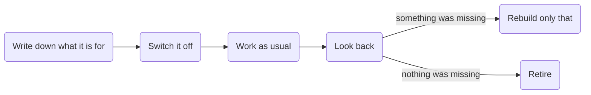

# Earn its place



- Tests whether a skill, or a set of skills, still earns its place. A skill does only if work goes worse without it, so the test is a window of real work, not a reading of the skill.
- Before the window, it uses [think-it-through](../think-it-through) from this repo to work out with you what the skill is for, and writes that into `intent.md`. The install below adds both.
- Afterwards, it judges the sessions the skill would have touched against `intent.md`, and looks just as hard for needs nobody wrote down.
- Too few relevant sessions mean the window was too short or the skill is no longer needed. It says which it thinks.

## Install

```bash
npx skills add byMarcoVogt/skills --skill earn-its-place --skill think-it-through -g
```

This needs Node.js 22.20 or newer. Or copy both folders yourself:

| Agent | Put the folders in |
|---|---|
| Claude Code | `~/.claude/skills/` |
| Codex | `~/.agents/skills/` |
| Other agents that read `SKILL.md` | that agent's skills folder |

## License

[MIT](LICENSE)
