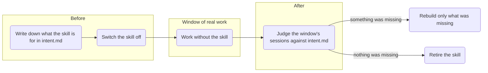

# Earn its place



Tests whether a skill, or a set of skills, still earns its place. A skill does only if work goes worse without it, so the test is a window of real work, not a reading of the skill.

- **Before**: with [think-it-through](../think-it-through) from this repo, Earn its place works out with you what the skill is for and writes that into `intent.md`. Then it proposes a test plan and, once you agree, switches the skill off. The install below adds both skills.
- **Window**: you work as you would anyway. Earn its place keeps copies of the sessions and schedules the second pass on this machine.
- **After**: the second pass judges the sessions the skill would have touched against `intent.md`, and looks just as hard for needs nobody wrote down. If there were too few relevant sessions, the window was too short or the skill is no longer needed, and the second pass says which.

## Install

```bash
npx skills add byMarcoVogt/skills --skill earn-its-place --skill think-it-through -g
```

Or copy manually:

| Agent | Put the folders in |
|:---:|:---:|
| Claude Code | `~/.claude/skills/` |
| Codex | `~/.agents/skills/` |
| Other agents that read `SKILL.md` | that agent's skills folder |

## License

[MIT](LICENSE)
