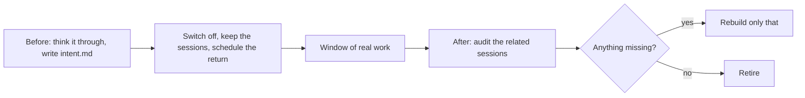

# Earn its place

Test whether a skill, or a set of skills, still earns its place.

Most skills only grow. Nobody checks whether today's model still needs them. This skill checks by switching them off for a window of real work, then coming back to see what went missing.

The audit also looks for needs nobody wrote down, which the window turned up.

## Use it

Install it together with [think-it-through](../think-it-through), which it uses to find out what your skills are for. Then ask in plain words, for example "does my review skill still pay off?". The skill proposes how long the window should be. It keeps copies of the sessions and schedules its own return on your machine. A scheduler that runs remotely can't read your transcripts.

## Status

2.0, not yet run on a real trial. Four models rebuilt the skill blind from the same idea and then reviewed the short version blind. Every line traces back to that, to a repeated miss in earlier skill reviews, or to a call I made. Lines that were cut on purpose include a prebuilt hook and scheduled task: one sentence lets the model set them up.

## License

[MIT](LICENSE)
