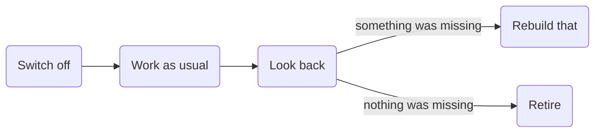

# Earn its place

<h4 align="center">What does it do?</h4>

<p align="center">It tests whether a skill still earns its place.<br>
It switches the skill off for a window of real work,<br>
then rebuilds only what went missing, or retires it.</p>

<h4 align="center">Why switch a skill off?</h4>

<p align="center">Most skills only grow, while the models keep getting better.<br>
Reading a skill can't tell you whether today's model still needs it.<br>
Working without it can.</p>

<h4 align="center">What does it look at afterwards?</h4>

<p align="center">The sessions the skill would have touched, judged against what you wrote down at the start.<br>
And just as hard: needs nobody wrote down.</p>



## Install

earn-its-place uses [think-it-through](../think-it-through) from this repo to find out what your skills are for, so install both.

```bash
npx skills add byMarcoVogt/skills --skill earn-its-place --skill think-it-through -g
```

This needs Node.js 22.20 or newer. Or copy both folders yourself:

| Agent | Put the folders in |
|---|---|
| Claude Code | `~/.claude/skills/` |
| Codex | `~/.agents/skills/` |
| Other agents that read `SKILL.md` | that agent's skills folder |

Then ask in plain words, for example "does my review skill still pay off?". It proposes how long the window should be, keeps copies of the sessions and schedules its own return on your machine. A scheduler that runs remotely can't read your transcripts.

## License

[MIT](LICENSE)
