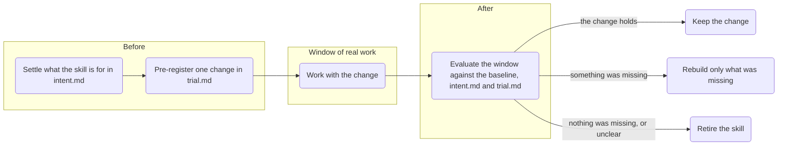

# Skill trials

Previously Earn its place (`/earn-its-place`).



Tests whether a skill, or a set of skills, still earns its place. A skill does only if work goes worse without it, so the test is a window of real work, not a reading of the skill.

- **Before**: with [think-it-through](../think-it-through) from this repo, you and Skill trials settle whether you need the skill and what it should do. The outcome goes into `intent.md`. If the skill never fires or is covered elsewhere, it proposes retiring it right away. Otherwise it proposes one ablation or variant and pre-registers it in `trial.md`. The install below adds both skills.
- **Window**: you work as you would anyway. Skill trials makes the change in every agent that has the skill and keeps recent sessions that used it as the baseline. A scheduled task on this machine copies the window's sessions and starts the second pass when the window ends.
- **After**: the second pass evaluates the window against the baseline, `intent.md` and `trial.md`. It audits the transcripts of both for how often you had to intervene, by correcting or re-explaining, and looks just as hard for needs nobody wrote down. If you switched back during the window, that is the verdict. If the result is unclear, it proposes retiring the skill, unless `intent.md` names a rare harm the window couldn't show.

Two files in `~/skill-trials/<skill>/`, outside the skill folders, so a change to a skill can't touch them:

- **`intent.md`**: the outcome of your discussion. Do you need the skill, what should it do, what do you like about it. It outlasts single trials.
- **`trial.md`**: one trial. Before the window, its criteria (ex ante). After the window, its evaluation and verdict (ex post).

Terms the skill uses:

- **Ablation**: one part removed, the rest unchanged. Switching the whole skill off is the largest ablation. An ablation only has to do no worse.
- **Variant**: one part condensed or rewritten. Condensing only has to do no worse. A rewrite has to do better where `trial.md` said it would.
- **Pre-register**: write down before the window what should go worse or better and how many sessions it takes to decide, so the result can't be read to fit afterwards.
- **Baseline**: recent sessions with the skill as it was, the point of comparison for the window.

## Install

```bash
npx skills add byMarcoVogt/skills --skill skill-trials --skill think-it-through -g
```

Or copy manually:

| Agent | Put the folders in |
|:---:|:---:|
| Claude Code | `~/.claude/skills/` |
| Codex | `~/.agents/skills/` |
| Other agents that read `SKILL.md` | that agent's skills folder |

## License

[MIT](LICENSE)
