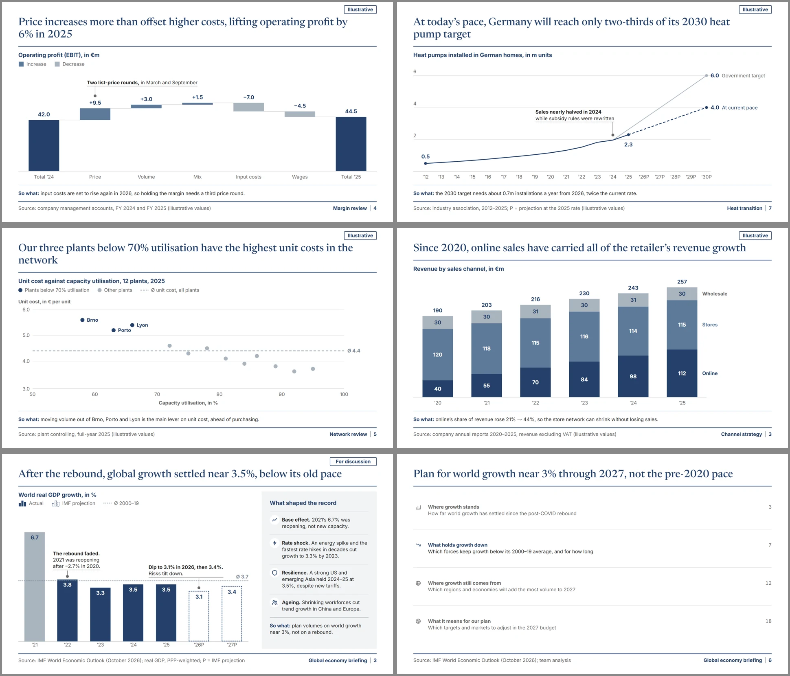
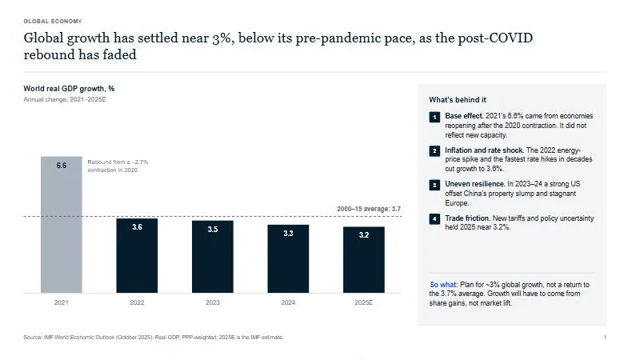
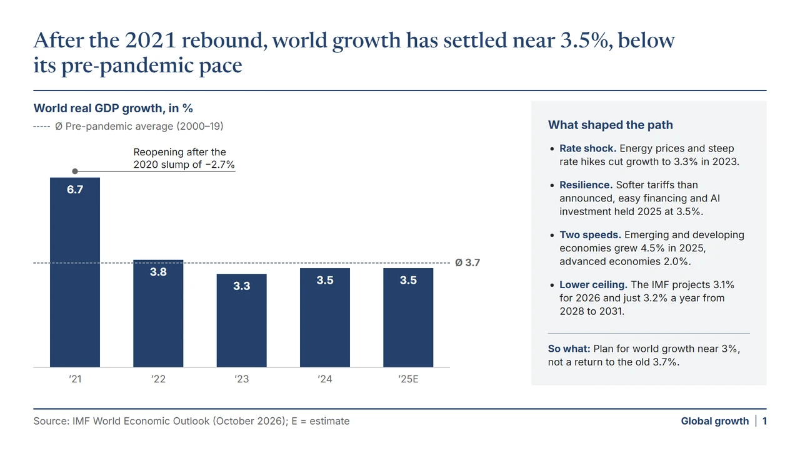
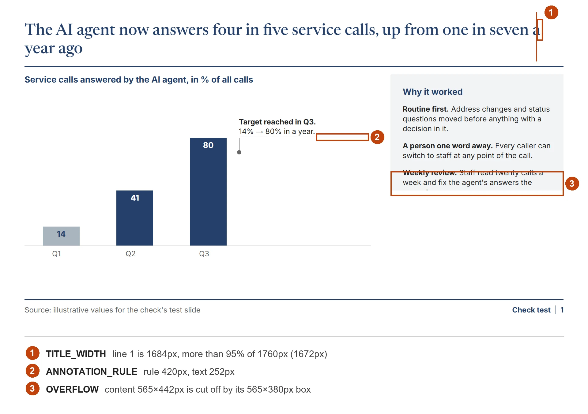

# Slides



<h4 align="center">What does it do?</h4>

<p align="center">It builds a deck in Claude Slides in my design system,<br>
and measures every slide against that system before I see it.</p>

<h4 align="center">Why my design system?</h4>

<p align="center">A model already knows what a good slide looks like in general.<br>
What it cannot know is my taste. So the skill carries my house style<br>
and does not try to suit everyone.</p>

## Real use

**The same prompt, a month apart.** On 23 October I asked for "a consulting slide in McKinsey style" on world growth, with no skill. On 23 November I sent the same prompt, word for word, with the skill. Both images are first drafts.

| Before, without the skill | After, with the skill |
|:---:|:---:|
|  |  |

What changed, and the rule behind each change:

- **Nothing above the title.** The action title is the slide, so the frame has no category line or eyebrow.
- **Navy, not black.** Message data is navy and context data is grey. The system has no pure black and no bright blue.
- **No numbering without an order.** The four reasons are not a sequence, so each one opens with a bold lead-in instead of a number.
- **A symbol where it says it faster.** The benchmark is labelled "Ø 3.7" at its end, and the period appears once in the legend.
- **Readable footer.** No text is smaller than 24px on the 1920 × 1080 canvas: a rule, the source on the left, the deck and page on the right.
- **Short years on the axis.** '21 to '25E instead of 2021 to 2025E, and "E = estimate" once in the footer.

**The check catches what the eye misses.** Before a deck is shown, `scripts/check.py` renders every slide at 1920 × 1080 and measures it against the design system's tokens. It looks for overflow, margins, the footer rule, title lines and width, notes against their text, the smallest font size, the minus sign and overlapping text. Each fault comes back with its name and its numbers, so the model can fix it before I look. Its test slide has three planted faults, and the check names each one:



For the same-prompt slide above, the first render's title line was 1,711 px wide, and the limit is 1,672 px. The check named it, and the slide was fixed before anyone saw it. Then the deck was published once: "1 of 1 slides pass". Run on the 13 slides of a deck from October, it names 17 faults, including the one note the October review had measured by hand.

## What is inside

| Part | What it holds |
|---|---|
| `SKILL.md` | How I work with the model: one panel ("Just build it, or do you want to choose?"), content before form, variants in place, nothing from the brief dropped, and no deck shown before it is checked. |
| `design-system/` | My house style as files: the brand book (`README.md`), `tokens.json`, and ten slide forms, each with a rule sheet and a rendered preview in `previews/`. `components/Cover/` is the design system's own title card, not a slide. |
| `scripts/check.py` | The check. Margins, the footer rule, the title width, the smallest font size and the colours come from `tokens.json`; the 1920 × 1080 canvas and the house frame (a title, a footer rule) are built in. |
| `storyline/` | Optional ghost decks: alternative storylines to pick from before any slide is built. |

## Install

```bash
npx skills add byMarcoVogt/skills --skill slides -g
```

Or copy manually:

| Agent | Put the folder in |
|:---:|:---:|
| Claude Code | `~/.claude/skills/` |
| Other agents that read `SKILL.md` | that agent's skills folder |

The skill builds in Claude Slides, so it needs a Claude surface with Artifacts. On the first run it offers to create the Marco Vogt Slides design system from `design-system/`.

The check needs Python 3 and a Chromium:

```bash
pip install playwright
python -m playwright install chromium-headless-shell
```

Or point the `CHROME` variable at any Chrome or Chromium you have.

**Your own design system.** Put its name in the marked line at the top of `SKILL.md`, or leave that line empty to be asked each time. The check then reads your system's `tokens.json`. It needs the spacing tokens `margin-top`, `margin-side`, `margin-bottom`, `footer-rule` and `title-line-max` the colour tokens `muted` and `surface` as `#rrggbb`, and the type groups with their font sizes, and it expects slides with a title and a footer rule. Where those are missing, the skill says "not checked" for that deck.

## License

[MIT](LICENSE). The fonts in the design system, Newsreader and Inter, are loaded from Google Fonts under the SIL Open Font License.
