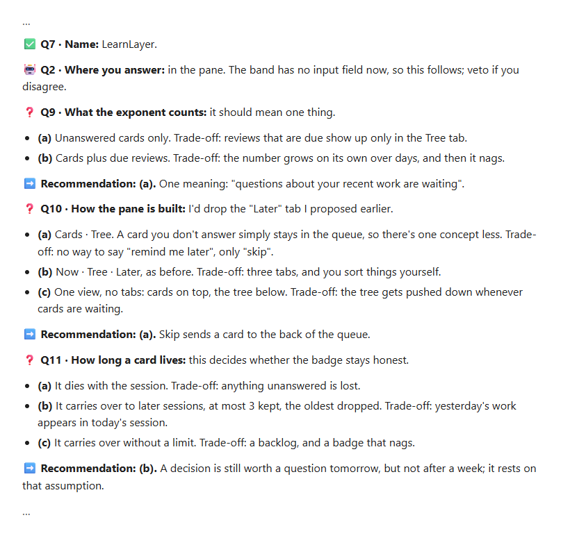
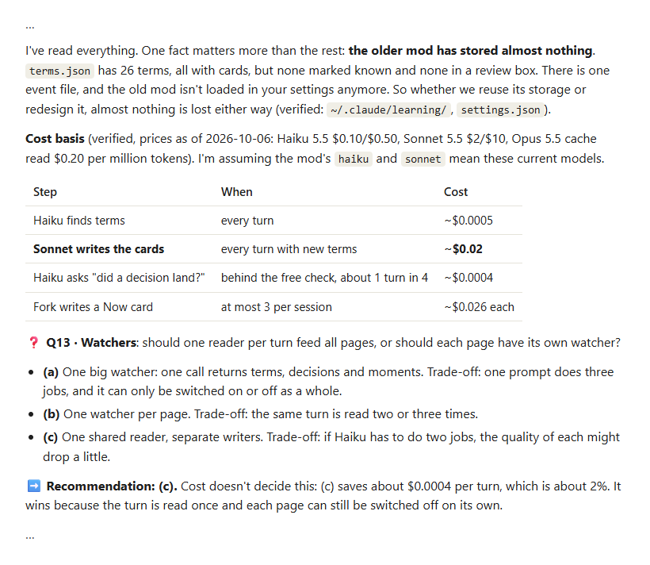
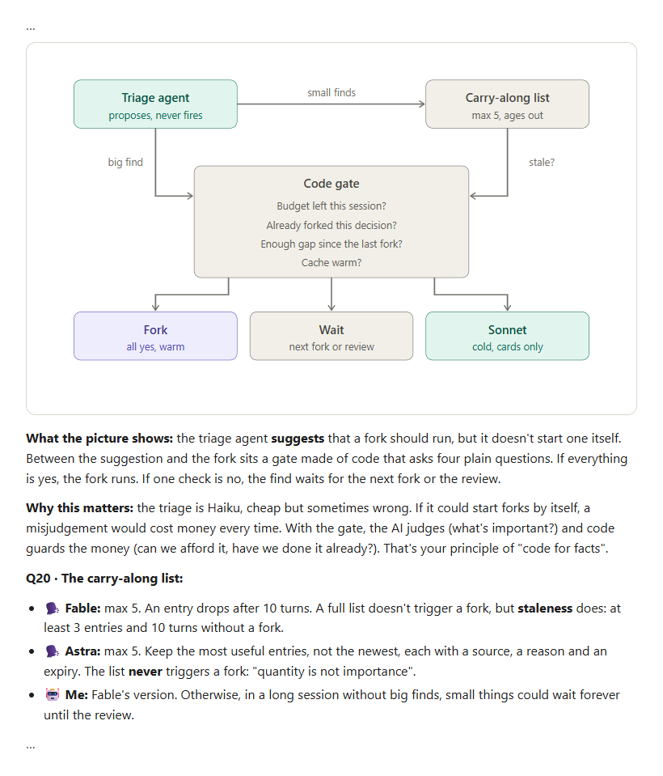

# think-it-through


<h4 align="center">What does it do?</h4>

<p align="center">It interviews you about an idea, plan or decision, one decision at a time,<br>
until scattered ideas and thoughts form one shared understanding.</p>

<h4 align="center">Why start with alignment?</h4>

<p align="center">Shared understanding is the baseline for any good work.<br>
There is no shortcut to it. You reach it only by working closely<br>
with the agent, question by question, until the picture is clear.</p>

## Real use

**The skill offers options with their trade-offs, and recommends one for each question.**



**The skill checks what it can, in your files and on the web, before it asks.**



**The skill shows a picture, explains what it means, and on hard choices proposes asking other models, where you have access to them.**



## Install

think-it-through is a plain [Agent Skill](https://agentskills.io): a folder with a `SKILL.md`.

```bash
npx skills add byMarcoVogt/skills --skill think-it-through -g
```

This needs Node.js 22.20 or newer. [`skills`](https://github.com/vercel-labs/skills) asks which agents to install for.

Or copy the folder yourself:

| Agent | Put the folder in |
|---|---|
| Claude Code | `~/.claude/skills/` |
| Codex | `~/.agents/skills/` |
| Other agents that read `SKILL.md` | that agent's skills folder |

Your agent picks it up when your request matches, for example "interview me", "grill me" or a pasted brain dump, including mid-session. You can also call it by name: `/think-it-through` in Claude Code, `$think-it-through` in Codex.

## License

[MIT](LICENSE). Inspired by [grill-me](https://github.com/mattpocock/skills) by Matt Pocock (MIT).
